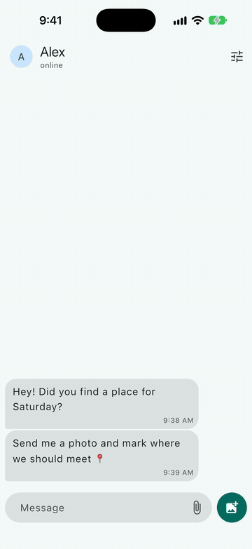
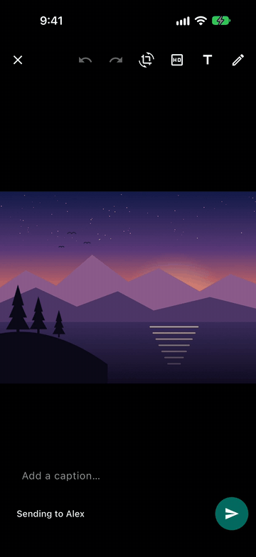
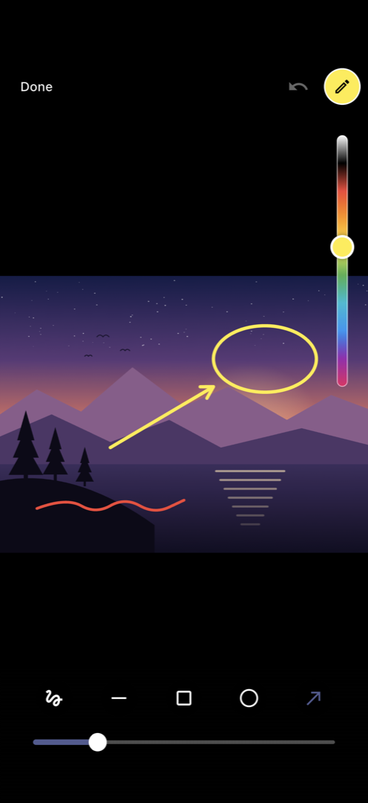
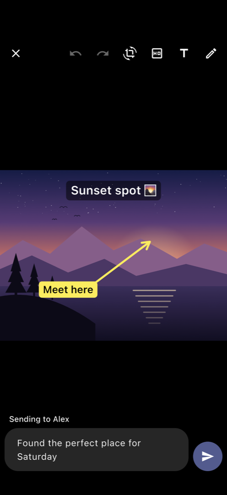
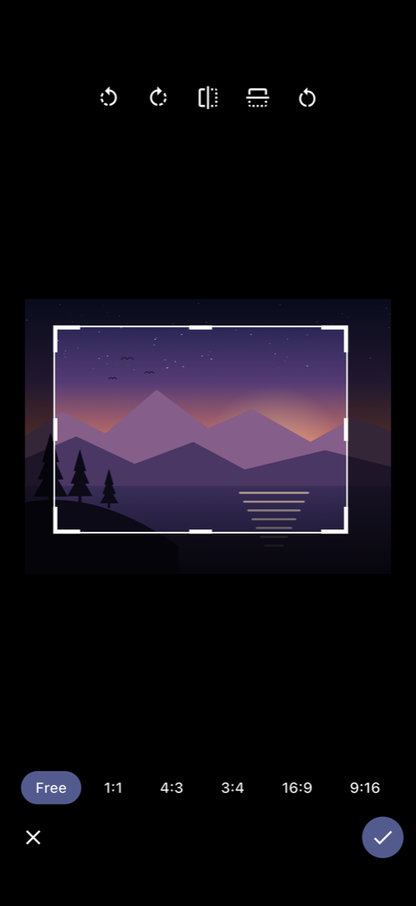
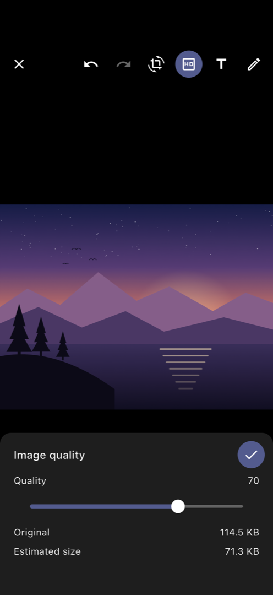
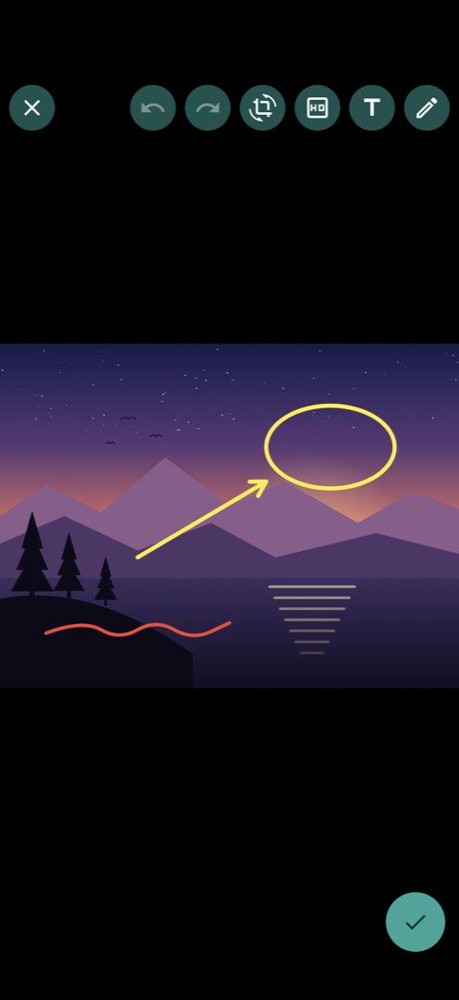

# chat_image_editor

<p align="center">
  <a href="https://pub.dev/packages/chat_image_editor">
    
  </a>
  <a href="https://pub.dev/packages/chat_image_editor/score">
    
  </a>
  <a href="https://pub.dev/packages/chat_image_editor/score">
    
  </a>
  
  <a href="https://github.com/ashiqu-ali/chat_image_editor">
    
  </a>
  <a href="https://github.com/ashiqu-ali/chat_image_editor/blob/main/LICENSE">
    
  </a>
</p>

<p align="center">
  A <strong>WhatsApp-style image editor</strong> for chat apps: <strong>draw</strong>, add <strong>text</strong>, <strong>crop</strong>, <strong>rotate</strong>, <strong>compress</strong> and <strong>send with a caption</strong>.<br/>
  Pure Dart, painted with <code>CustomPaint</code>. No platform code, no setup: it runs everywhere Flutter does.<br/>
  Matches your app's <code>ColorScheme</code> out of the box, and every color, icon, string and UI region can be replaced.
</p>

<p align="center">
  <a href="https://www.buymeacoffee.com/ashiqu.ali">
    
  </a>
</p>

---

## Preview

<p align="center">
  
  &nbsp;&nbsp;&nbsp;&nbsp;
  
  &nbsp;&nbsp;&nbsp;&nbsp;
  
</p>
<p align="center">
  <em>Pick, edit and send &nbsp;&nbsp;&nbsp;&nbsp;&nbsp;&nbsp;&nbsp;&nbsp;&nbsp;&nbsp;&nbsp;&nbsp;&nbsp;&nbsp;&nbsp;&nbsp;&nbsp;&nbsp;&nbsp;&nbsp;&nbsp;&nbsp;&nbsp;&nbsp; Draw and pick a color &nbsp;&nbsp;&nbsp;&nbsp;&nbsp;&nbsp;&nbsp;&nbsp;&nbsp;&nbsp;&nbsp;&nbsp;&nbsp;&nbsp;&nbsp;&nbsp;&nbsp;&nbsp;&nbsp;&nbsp;&nbsp;&nbsp;&nbsp;&nbsp; Text layers</em>
</p>

<p align="center">
  
  &nbsp;&nbsp;&nbsp;&nbsp;
  
</p>
<p align="center">
  <em>Crop, rotate and flip &nbsp;&nbsp;&nbsp;&nbsp;&nbsp;&nbsp;&nbsp;&nbsp;&nbsp;&nbsp;&nbsp;&nbsp;&nbsp;&nbsp;&nbsp;&nbsp;&nbsp;&nbsp;&nbsp;&nbsp;&nbsp;&nbsp; Compress with a size estimate</em>
</p>

<p align="center">
  
  &nbsp;
  
  &nbsp;
  
  &nbsp;
  
  &nbsp;
  
</p>
<p align="center">
  <em>Draw &nbsp;&nbsp;&nbsp;&nbsp;&nbsp;&nbsp;&nbsp;&nbsp;&nbsp;&nbsp;&nbsp;&nbsp;&nbsp;&nbsp;&nbsp;&nbsp;&nbsp;&nbsp;&nbsp;&nbsp;&nbsp;&nbsp;&nbsp;&nbsp;&nbsp; Text &nbsp;&nbsp;&nbsp;&nbsp;&nbsp;&nbsp;&nbsp;&nbsp;&nbsp;&nbsp;&nbsp;&nbsp;&nbsp;&nbsp;&nbsp;&nbsp;&nbsp;&nbsp;&nbsp;&nbsp;&nbsp;&nbsp;&nbsp;&nbsp;&nbsp; Crop &nbsp;&nbsp;&nbsp;&nbsp;&nbsp;&nbsp;&nbsp;&nbsp;&nbsp;&nbsp;&nbsp;&nbsp;&nbsp;&nbsp;&nbsp;&nbsp;&nbsp;&nbsp;&nbsp;&nbsp;&nbsp; Compress &nbsp;&nbsp;&nbsp;&nbsp;&nbsp;&nbsp;&nbsp;&nbsp;&nbsp;&nbsp;&nbsp;&nbsp;&nbsp;&nbsp;&nbsp;&nbsp; Done mode</em>
</p>

---

## Table of Contents

- [Features](#-features)
- [How It Works](#-how-it-works)
- [Installation](#-installation)
- [Quick Start](#-quick-start)
  - [Open the Editor](#1-open-the-editor)
  - [Embed the Widget](#2-embed-the-widget)
  - [Done Mode](#3-done-mode)
  - [Cap the File Size](#4-cap-the-file-size)
  - [Drive It with a Controller](#5-drive-it-with-a-controller)
  - [Example App](#example-app)
- [Customization](#-customization)
  - [Theme](#theme)
  - [Icons](#icons)
  - [Strings and Localization](#strings-and-localization)
  - [Caption Field](#caption-field)
  - [Send Button](#send-button)
  - [Builders](#builders)
  - [Discard Dialog](#discard-dialog)
  - [Behaviour](#behaviour)
- [Export & Compression](#-export--compression)
- [Performance](#-performance)
- [Result Reference](#-result-reference)
- [API Reference](#-api-reference)
- [Architecture](#-architecture)
- [Troubleshooting](#-troubleshooting)
- [Contributing](#-contributing)
- [Connect](#-connect)
- [License](#license)

---

## ✨ Features

| Feature | What you get |
|---|---|
| Draw | Freehand pen, line, rectangle, circle and arrow, with a brush size slider. Colors come from a vertical gradient slider: drag along it to pick any color between your palette's stops. |
| Pen mode | While drawing, the top bar morphs into a **Done** pill, undo and a swatch of the pen color, and the chrome fades out while a stroke is drawn. Opt in to `hideSystemBarsWhileDrawing` for a full-screen canvas. |
| Text | Add, edit, move, pinch to resize and twist to rotate. Center alignment guides, solid or translucent backgrounds, drag to the bin to delete. |
| Crop, rotate, flip | Draggable corners and edges, a rule-of-thirds grid, aspect-ratio presets, quarter turns and mirroring. Every crop tool sits in one bottom row. |
| Compress | A quality sheet (Low, Medium, High) with the original size, a live size estimate and an **Apply** button. |
| Size cap | `ExportOptions.maxBytes` steps JPEG quality down until the file fits. |
| Undo and redo | For every edit, one step per finished action. |
| Caption and send | A real `TextFormField` (validator, max length, formatters, your own controller) above a recipient chip and the send button. Optional long press and enable/disable control. |
| Done mode | No caption, a single done button: for avatars, attachments and forms. |
| Zoom | Pinch to zoom while no tool is open. |
| Matches your app | Accents come from your `ColorScheme`. Override any color, text style or size per editor, or app-wide as a `ThemeExtension`. |
| Replace anything | Every icon and string (for localization), plus builders for the top bar, bottom bar, send and done buttons, loading and error views, and the discard dialog. |
| Adaptive discard prompt | Closing with unsaved edits asks first: a Cupertino alert on iOS and macOS, a Material dialog elsewhere. |
| Sharp, small output | Edits are stored as data and rendered once at export, at full resolution, capped by `maxLongEdge`. JPEG or PNG. |
| Smooth | Encoding runs in a background isolate (on the web, on the main thread). The source is decoded only at the size it's needed. |
| Measurable | `ExportStats` on every result, `chat_image_editor.*` spans in DevTools, a benchmark suite and frame-timing tests. |
| Accessible | Tooltips and semantics labels on every control, a screen-reader friendly color slider, and reduced motion respected. |
| Pure Dart | No platform channels, no permissions, no native setup. Android, iOS, web, macOS, Windows and Linux. |

---

## 📱 How It Works

```
┌──────────────────────────────────────────────────────────────────┐
│                          Your chat app                           │
│                                                                  │
│   Pick a photo (image_picker, camera, file, network ...)         │
│          │  Uint8List                                            │
│          ▼                                                       │
│   ChatImageEditor.open(context, bytes)                           │
│          │                                                       │
│          ▼                                                       │
│   Edit: draw, text, crop / rotate / flip, quality, caption       │
│          │  every edit is data (ImageEditValue), undoable        │
│          ▼                                                       │
│   User taps Send (or Done)  ──►  export                          │
│          │                                                       │
│          │   1. decode the source once, capped at maxLongEdge    │
│          │   2. render the edits at full size (CustomPaint)      │
│          │   3. encode JPEG / PNG in a background isolate        │
│          │   4. over maxBytes? step quality down and re-encode   │
│          ▼                                                       │
│   ChatImageEditorResult: bytes, caption, size, ExportStats       │
│          │                                                       │
│          ▼                                                       │
│   Upload and send it with your own chat backend                  │
└──────────────────────────────────────────────────────────────────┘
```

**Key idea:** the package handles the **editing UI and the encoding** only.
It never uploads anything and never talks to a server. You hand it encoded
bytes, and you get encoded bytes and a caption back:

1. The user picks a photo → you call `ChatImageEditor.open(context, bytes)`
2. The user edits and taps Send → the editor exports and the future completes with a `ChatImageEditorResult`
3. The user closes the editor → the future completes with `null` (after a discard prompt if there were edits)
4. You upload `result.bytes` with `result.caption` → your chat shows the message

---

## 📦 Installation

Add to your `pubspec.yaml`:

```yaml
dependencies:
  chat_image_editor: ^1.0.0
```

Then run:

```bash
flutter pub get
```

Or in one step: `flutter pub add chat_image_editor`.

**Requirements:**

| | Minimum |
|---|---|
| Flutter | 3.32.0 |
| Dart SDK | 3.8.0 |
| Platforms | Android, iOS, Web, macOS, Windows, Linux |
| Platform setup | None: no native code, no permissions, no `Info.plist` or manifest entries |

> The editor itself needs no permissions. If you pick photos with
> [`image_picker`](https://pub.dev/packages/image_picker), follow that
> package's setup for the gallery and camera.

---

## 🚀 Quick Start

### 1. Open the Editor

```dart
import 'dart:typed_data';

import 'package:chat_image_editor/chat_image_editor.dart';
import 'package:flutter/material.dart';

Future<void> editAndSend(BuildContext context, Uint8List photo) async {
  final result = await ChatImageEditor.open(context, photo);
  if (result == null) return; // The user closed the editor.

  await uploadImage(                // Your upload code.
    result.bytes,                   // Encoded JPEG (default) or PNG
    mimeType: result.mimeType,      // 'image/jpeg'
    caption: result.caption,        // Trimmed, '' when empty
    width: result.width,
    height: result.height,
  );
}
```

`photo` is any encoded image Flutter can decode (JPEG, PNG, WebP, …). Get it
from wherever you like, for example `XFile.readAsBytes()` from
`image_picker`:

```dart
final file = await ImagePicker().pickImage(source: ImageSource.gallery);
if (file == null || !context.mounted) return;
await editAndSend(context, await file.readAsBytes());
```

> **Tip:** pass the original file. The editor decodes it only at the size it
> needs, so resizing in the picker just adds a second lossy encode.

**What happens:**
- `open` pushes a full-screen route (on the root navigator by default) and completes when the editor closes
- **Send** validates the caption, exports (encoding off the UI thread) and pops the route with the result
- **Close** asks before discarding unsaved edits or a typed caption, then pops with `null`
- The system **back** gesture first closes an open tool or text entry, then behaves like **Close**

### 2. Embed the Widget

To place the editor in your own route or layout, use the widget and handle
`onComplete` and `onCancel`:

```dart
class EditPhotoPage extends StatelessWidget {
  const EditPhotoPage({super.key, required this.photo});

  final Uint8List photo;

  @override
  Widget build(BuildContext context) {
    return ChatImageEditor(
      image: photo,
      onComplete: (result) => Navigator.of(context).pop(result),
      onCancel: () => Navigator.of(context).pop(),
    );
  }
}
```

> If you leave `onComplete` or `onCancel` out, the editor pops its route with
> the result or with `null`. The editor is designed to fill the screen.

### 3. Done Mode

Done mode swaps the caption and send button for a single done button. Use it
when you only need the edited image, such as a profile photo:

```dart
final result = await ChatImageEditor.open(
  context,
  photo,
  config: const ChatImageEditorConfig(
    mode: ChatImageEditorMode.done,
    tools: [EditorTool.crop],
    cropAspectRatios: [1],
  ),
);
```

`result.caption` is always empty in done mode.

### 4. Cap the File Size

Chat backends usually limit uploads. Scale large photos down and let the
editor step JPEG quality down until the file fits:

```dart
final result = await ChatImageEditor.open(
  context,
  photo,
  config: const ChatImageEditorConfig(
    export: ExportOptions(
      maxLongEdge: 1600,      // Long side in pixels
      quality: 80,            // Starting JPEG quality
      maxBytes: 1024 * 1024,  // 1 MB
    ),
  ),
);

if (result != null && result.exceedsMaxBytes) {
  // Even minQuality didn't fit: warn the user or upload anyway.
}
```

> With these settings, the example app sent a 12 MP, 5.8 MB photo as a
> 230 KB JPEG. See [Export & Compression](#-export--compression).

### 5. Drive It with a Controller

Pass your own `ChatImageEditorController` to drive the editor from code or to
read its state. It's a `ChangeNotifier`, so you can listen to it:

```dart
final controller = ChatImageEditorController();

ChatImageEditor(image: photo, controller: controller);

// Later, from your own buttons:
controller.selectTool(EditorTool.draw);
controller.setDrawColor(Colors.yellow);
if (controller.canUndo) controller.undo();

// Rotate in a crop session and keep it as one undo step.
controller.selectTool(EditorTool.crop);
controller.rotateRight();
controller.confirmCrop();

final result = await controller.export(caption: 'Hello');
```

> The editor disposes the controller it creates itself. A controller you pass
> in is yours to dispose.

### Example App

The [example](example) app is a chat. Pick a photo from the gallery or the
camera (or a drawn sample photo), edit it, and send it with a caption. Each
sent photo arrives as a bubble with its file size and export time; tapping
it opens a viewer with the full `ExportStats`. The whole integration is one
call in [`chat_photo_editor.dart`](example/lib/src/chat/chat_photo_editor.dart).

A customization screen, behind the tune button in the app bar, shows the
default look, a custom theme, done mode, a size limit, localized strings and
an external controller. See [example/README.md](example/README.md) to run it.

---

## 🎨 Customization

**Every option is optional.** With no configuration the editor already
matches your app. The full reference, with every field and its default, is
in [doc/CUSTOMIZATION.md](doc/CUSTOMIZATION.md).

### Theme

Out of the box the editor uses a dark, full-bleed canvas so photos stand out,
in both light and dark app themes. Its accent (send button, sliders, the
active tool, alignment guides and the first pen color) comes from your app's
`ColorScheme.primary`: change your seed color and the editor follows.

Override any single field with `ChatImageEditorThemeData`. Fields you leave
`null` keep inheriting:

```dart
ChatImageEditor.open(
  context,
  photo,
  theme: const ChatImageEditorThemeData(
    sendButtonColor: Colors.teal,
    captionFillColor: Color(0xCC1F2C34),
    palette: [Colors.white, Colors.black, Colors.red, Colors.amber],
  ),
);
```

To style every editor in your app at once, register the theme as a
`ThemeExtension`:

```dart
MaterialApp(
  theme: ThemeData(
    colorScheme: ColorScheme.fromSeed(seedColor: Colors.indigo),
    extensions: const [
      ChatImageEditorThemeData(backgroundColor: Color(0xFF101010)),
    ],
  ),
  home: const HomePage(),
);
```

Each field resolves in this order:

1. the `theme` you pass to the editor,
2. a `ChatImageEditorThemeData` in your app's `ThemeData.extensions`,
3. a default derived from your `ColorScheme` and `TextTheme`.

| Field | Default |
|---|---|
| `primaryColor` | `ColorScheme.primary` (send button, sliders, active tool, guides, first pen color) |
| `backgroundColor` / `foregroundColor` | Black / white |
| `toolbarBackgroundColor` | Black, 54%: behind buttons, the **Done** pill and the recipient chip |
| `captionFillColor` | Black, 54%: the photo shows through the caption field |
| `scrimColor` | Black, 60%: behind text entry and under the bottom controls |
| `palette` | White, black, red, orange, yellow, green, cyan, blue, purple, pink: the color slider's stops |
| `sendButtonSize` / `iconSize` | `52` / `24` |

`ChatImageEditorThemeData` has a field for every color, text style and size
the editor uses; see the [theme reference](doc/CUSTOMIZATION.md#theme).

### Icons

Pass any widget: an `Icon`, an SVG or an image. Icons without their own color
pick up the themed color and size:

```dart
ChatImageEditor.open(
  context,
  photo,
  icons: const ChatImageEditorIcons(
    send: Icon(Icons.arrow_upward),
    draw: Icon(Icons.brush), // Also shown on the pen-color swatch
  ),
);
```

### Strings and Localization

Every user-facing string, tooltip and semantics label lives in
`ChatImageEditorStrings`, with English defaults. Pass a translated instance:

```dart
ChatImageEditor.open(
  context,
  photo,
  strings: ChatImageEditorStrings(
    captionHint: 'Ajouter une légende…',
    send: 'Envoyer',
    done: 'OK',             // Done button and the Done pill
    apply: 'Appliquer',     // Compress sheet button
    color: 'Couleur',       // Color slider semantics label
    discardTitle: 'Annuler les modifications ?',
    discardConfirm: 'Annuler',
    keepEditing: 'Continuer',
    formatQuality: (quality) => switch (quality) {
      <= 40 => 'Basse · $quality',
      <= 75 => 'Moyenne · $quality',
      _ => 'Haute · $quality',
    },
  ),
);
```

Pick the instance from `Localizations.localeOf(context)` or fill it from
your app's generated localizations. Three fields are functions:
`formatBytes` (file sizes), `colorLabel` (screen-reader names for the color
slider) and `formatQuality` (the compress sheet's `Low · 40`, `Medium · 70`,
`High · 90`).

### Caption Field

The caption is a real `TextFormField`. Configure it with
`CaptionFieldConfig`; `header` appears as a chip below the field, next to the
send button:

```dart
ChatImageEditor.open(
  context,
  photo,
  captionField: CaptionFieldConfig(
    maxLength: 500,
    maxLines: 4,
    validator: (value) =>
        (value ?? '').contains('http') ? 'Links are not allowed' : null,
    autovalidateMode: AutovalidateMode.onUserInteraction,
    header: const Text('Sending to Family'),
  ),
);
```

Sending is blocked while the validator returns an error. Pass `controller` or
`initialValue` to prefill the caption (for example with the draft from your
chat's message field). Set `enabled: false` to hide the caption and keep only
the send button.

### Send Button

- `sendEnabled` takes a `ValueListenable<bool>`. The send button is disabled
  while it's `false`, for example while you're offline.
- `onSendLongPress` runs on a long press of the send button. It receives an
  `export` function so you can render the image on demand, for example after
  the user picks a time to schedule the message. Return `true` to close the
  editor or `false` to stay.

```dart
final online = ValueNotifier<bool>(true);

ChatImageEditor.open(
  context,
  photo,
  sendEnabled: online,
  onSendLongPress: (context, export) async {
    final time = await showTimePicker(
      context: context,
      initialTime: TimeOfDay.now(),
    );
    if (time == null) return false;
    final result = await export();
    if (result == null) return false;
    scheduleImage(result, time); // Your code.
    return true;
  },
);
```

### Builders

Replace whole parts of the UI with `ChatImageEditorBuilders`: the top bar,
the bottom bar, the send or done button, the loading and error views, and the
discard confirmation.

```dart
ChatImageEditor.open(
  context,
  photo,
  builders: ChatImageEditorBuilders(
    sendButton: (context, details) => FilledButton.icon(
      onPressed: details.onPressed,
      onLongPress: details.onLongPress,
      icon: const Icon(Icons.send),
      label: Text(details.busy ? 'Sending…' : 'Send'),
    ),
  ),
);
```

Inside a builder, `ChatImageEditorScope.of(context)` gives you the resolved
theme, icons, strings, config and controller, so custom widgets can match the
editor. A custom `topBar` replaces the built-in bar in every mode, including
the pen-mode bar, so give users a way to stop drawing
(`controller.closeTool()`).

### Discard Dialog

Closing the editor with unsaved edits or a typed caption asks first. The
built-in prompt is platform-adaptive: a Cupertino alert on iOS and macOS, a
Material dialog elsewhere, both using `discardTitle`, `discardMessage`,
`discardConfirm` and `keepEditing` from the strings.

Replace it with your own UI through `ChatImageEditorBuilders.confirmDiscard`.
Return `true` to discard:

```dart
ChatImageEditorBuilders(
  confirmDiscard: (context) async {
    final discard = await showModalBottomSheet<bool>(
      context: context,
      builder: (context) => ListTile(
        leading: const Icon(Icons.delete_outline),
        title: const Text('Discard this photo'),
        onTap: () => Navigator.of(context).pop(true),
      ),
    );
    return discard ?? false;
  },
);
```

Turn the prompt off entirely with `ChatImageEditorConfig(confirmDiscard: false)`.

### Behaviour

`ChatImageEditorConfig` switches features on and off:

```dart
const config = ChatImageEditorConfig(
  tools: [EditorTool.draw, EditorTool.text, EditorTool.crop],
  shapes: [ShapeType.freehand, ShapeType.arrow],
  cropAspectRatios: [1],
  enableHaptics: false,
  hideSystemBarsWhileDrawing: true,
);
```

| Option | Default | What it does |
|---|---|---|
| `mode` | `ChatImageEditorMode.send` | `send`: caption and send button. `done`: a single done button. |
| `tools` | crop, compress, text, draw | Tools in the top bar, in this order. Tools left out are hidden. |
| `shapes` | all `ShapeType` values | Shapes the draw tool offers. With one shape, no picker shows. |
| `cropAspectRatios` | `1`, `4/3`, `3/4`, `16/9`, `9/16` | Crop presets next to free cropping. Empty hides them. |
| `export` | `ExportOptions()` | How the result is encoded. See [Export & Compression](#-export--compression). |
| `previewMaxLongEdge` | `2048` | Longest side of the image decoded for editing. Preview sharpness and memory only. |
| `defaultStrokeWidth` / `minStrokeWidth` / `maxStrokeWidth` | `0.008` / `0.002` / `0.03` | Brush size, as a fraction of the image's shortest side. |
| `defaultFontSize` / `minFontSize` / `maxFontSize` | `0.06` / `0.02` / `0.25` | Text size, as a fraction of the image's shortest side. |
| `confirmDiscard` | `true` | Asks before discarding unsaved edits or a caption. |
| `enableZoom` | `true` | Pinch-to-zoom while no tool is open. |
| `enableHaptics` | `true` | Light haptic feedback on alignment guides, color picks and the delete target. |
| `showUndoRedo` | `true` | Undo and redo buttons in the top bar (undo only while drawing). |
| `hideSystemBarsWhileDrawing` | `false` | Opt-in. Hides the status and navigation bars while the draw tool is open. |

---

## 📏 Export & Compression

`ChatImageEditorConfig.export` takes an `ExportOptions` that controls how the
result is encoded. Export always re-renders from the source bytes, never from
the preview, so the output is as sharp as the source allows.

```dart
const config = ChatImageEditorConfig(
  export: ExportOptions(
    format: ExportFormat.jpeg, // or ExportFormat.png
    quality: 85,               // Used unless the user applies one in the compress sheet
    maxLongEdge: 1600,         // Scale down large photos; null keeps full size
    maxBytes: 300 * 1024,      // Lower JPEG quality until the file fits
    minQuality: 40,            // Never go below this while fitting maxBytes
  ),
);
```

| Option | Default | What it does |
|---|---|---|
| `format` | `ExportFormat.jpeg` | JPEG (small, no transparency) or PNG (lossless, keeps transparency). |
| `quality` | `90` | JPEG quality, 1–100, unless the user applies one in the compress sheet. |
| `maxLongEdge` | `4096` | Longest side of the output in pixels. `null` keeps the full resolution. |
| `maxBytes` | `null` | Target file size in bytes. JPEG quality steps down until the file fits. |
| `minQuality` | `30` | Lowest quality the `maxBytes` search may use. |
| `encoder` | `null` | Your own `ImageEncoder`. `null` uses the built-in `DartImageEncoder`. |
| `backgroundColor` | white | Fills transparent pixels for JPEG output. |

### The size ladder

With `maxBytes` set, the first encode uses the starting quality. If the file
is too big, quality steps down by 10, never below `minQuality`, which is
always the last attempt:

```
attempt    1      2      3      4      5      6      7
quality    90 ->  80 ->  70 ->  60 ->  50 ->  40 ->  30 (minQuality)
           stops at the first attempt that fits maxBytes
```

If even `minQuality` doesn't fit, you get the smallest attempt and
`result.exceedsMaxBytes` is `true`. Each step is a full re-encode, so start
lower (`quality`), raise `minQuality` or lower `maxLongEdge` to keep it to one
or two; `result.stats.encodeAttempts` tells you how often it happens.

### The compress sheet

The compress tool lets the user choose the quality: a slider from 10 to 100
in steps of 10, labelled **Low**, **Medium** or **High**, with the original
file size and a live, debounced estimate of the new size. The slider is a
draft until the user taps **Apply**, which records the quality as one undo
step; tapping outside the sheet closes it unchanged. The applied quality
replaces `ExportOptions.quality`, and a `maxBytes` search starts from it.

Quality applies to JPEG only. If you export PNG you may want to leave
`EditorTool.compress` out of `config.tools`.

### Custom encoder

The built-in encoder is pure Dart (via [`image`](https://pub.dev/packages/image)),
so it works everywhere. To use a faster native encoder, implement
`ImageEncoder`. You get straight (not premultiplied) RGBA pixels:

```dart
class MyEncoder implements ImageEncoder {
  const MyEncoder();

  @override
  Future<Uint8List> encode(
    RgbaImage image, {
    required ExportFormat format,
    int quality = 90,
  }) async {
    // image.pixels holds width * height * 4 bytes, row by row.
    return encodeWithMyLibrary(
      image.pixels,
      image.width,
      image.height,
      format.mimeType,
      quality,
    );
  }
}

const config = ChatImageEditorConfig(
  export: ExportOptions(encoder: MyEncoder()),
);
```

---

## ⚡ Performance

### Export stats in your app

Every export reports how long it took in `result.stats` (an `ExportStats`),
so you can track export performance in your own analytics. The package
itself never sends anything anywhere.

```dart
final result = await ChatImageEditor.open(context, photo);
final stats = result?.stats;
if (stats != null) {
  analytics.logEvent('image_export', {
    'total_ms': stats.totalTime.inMilliseconds,
    'encode_ms': stats.encodeTime.inMilliseconds,
    'attempts': stats.encodeAttempts,
    'quality': stats.finalQuality,
    'source_bytes': stats.sourceByteLength,
    'output_bytes': stats.outputByteLength,
  });
}
```

### Timeline spans in DevTools

The expensive steps are wrapped in timeline spans whose names start with
`chat_image_editor.`. Run your app in profile mode, open DevTools'
**Performance** page and search the timeline events for `chat_image_editor`.
Release builds compile the spans out.

| Span | Covers |
|---|---|
| `chat_image_editor.load` / `.decode` | Decoding the preview, and any decode of encoded bytes |
| `chat_image_editor.export` | A whole export, with every `ExportStats` value at the end |
| `chat_image_editor.render` / `.rasterize` | Painting the export and reading back the pixels |
| `chat_image_editor.paint` | One `CompositionRenderer.paint`: every preview frame |
| `chat_image_editor.encode` / `.encode_pixels` | One encoder call, and its pixel work in the isolate |
| `chat_image_editor.fit_max_bytes` | The `maxBytes` quality ladder |
| `chat_image_editor.estimate_size` | A compress-sheet size estimate |

### Benchmarks

The `benchmark/` suite measures the hot paths on a synthesized 12 MP photo:

```bash
fvm flutter test benchmark
fvm dart run tool/benchmark_report.dart build/benchmark/results.json
```

Two rows from a run on a laptop (debug mode in the test engine, so compare
commits rather than predicting phone timings):

| Benchmark | p50 (ms) |
|---|---:|
| `load: 12 MP JPEG preview` | 77 |
| `export: JPEG q90, maxLongEdge 4096` | 694 |

`example/integration_test/editor_performance_test.dart` records frame
timings on a real device while drawing, dragging text, cropping and zooming.

### Tips

- **`maxLongEdge` sets the export cost.** Decode, render and encode all scale
  with the output pixel count; 2048 instead of 4096 is about four times less
  work and still sharp in a chat bubble.
- **`previewMaxLongEdge` sets the editing cost.** Lower it on low-memory
  devices; the export always re-decodes the source, so the result is the same.
- **`maxBytes` can multiply the encode time.** See [the size ladder](#the-size-ladder).
- **Size estimates are cached** per edit state and quality, so moving the
  compress slider back to a value it already showed is free.
- **A native `ImageEncoder` is the biggest single win** for large exports.

The span arguments, every benchmark, the frame-timing tests and how to read
them are in [doc/PERFORMANCE.md](doc/PERFORMANCE.md).

---

## 📋 Result Reference

`ChatImageEditor.open` and `ChatImageEditorController.export` return a
`ChatImageEditorResult`:

| Member | Type | Description |
|---|---|---|
| `bytes` | `Uint8List` | The encoded image |
| `width`, `height` | `int` | Pixel size of the encoded image |
| `format` | `ExportFormat` | `ExportFormat.jpeg` or `ExportFormat.png` |
| `mimeType` | `String` | `image/jpeg` or `image/png` |
| `fileExtension` | `String` | `jpg` or `png`, without the dot |
| `caption` | `String` | The caption, trimmed. Empty in done mode |
| `edits` | `ImageEditValue` | The edits that produced the image |
| `exceedsMaxBytes` | `bool` | `true` if a `maxBytes` target couldn't be met; `bytes` holds the smallest attempt |
| `stats` | `ExportStats?` | How long the export took; `null` for a result you build yourself |

`ExportStats`:

| Field | Type | Description |
|---|---|---|
| `decodeTime` | `Duration` | Decoding the source at the size the output needs |
| `renderTime` | `Duration` | Painting the edits and reading back the pixels |
| `encodeTime` | `Duration` | Encoding, summed over every attempt |
| `totalTime` | `Duration` | The whole export, at least the sum of the three phases |
| `encodeAttempts` | `int` | `1`, or more when `maxBytes` stepped quality down |
| `finalQuality` | `int?` | JPEG quality of the returned bytes; `null` for PNG |
| `sourceByteLength` | `int` | Size of the image you passed in |
| `outputByteLength` | `int` | Size of `bytes` |
| `outputWidth`, `outputHeight` | `int` | Pixel size of the result |

```dart
class ChatImageEditorResult {
  final Uint8List bytes;
  final int width;
  final int height;
  final ExportFormat format;
  final ImageEditValue edits;
  final String caption;
  final bool exceedsMaxBytes;
  final ExportStats? stats;
}
```

---

## 📚 API Reference

### `ChatImageEditor`

| Parameter | Type | Default | Description |
|---|---|---|---|
| `image` | `Uint8List` | required | Encoded source image (JPEG, PNG, WebP, …) |
| `controller` | `ChatImageEditorController?` | `null` | External controller; the editor creates and disposes its own when `null` |
| `config` | `ChatImageEditorConfig` | `ChatImageEditorConfig()` | Tools, mode, limits and export |
| `theme` | `ChatImageEditorThemeData?` | `null` | Color, text style and size overrides |
| `icons` | `ChatImageEditorIcons` | `ChatImageEditorIcons()` | Icon overrides |
| `strings` | `ChatImageEditorStrings` | `ChatImageEditorStrings()` | Text overrides, for localization |
| `captionField` | `CaptionFieldConfig` | `CaptionFieldConfig()` | The caption `TextFormField` |
| `builders` | `ChatImageEditorBuilders` | `ChatImageEditorBuilders()` | Replacement UI regions |
| `sendEnabled` | `ValueListenable<bool>?` | `null` | Disables the send button while `false` |
| `onSendLongPress` | `SendLongPressCallback?` | `null` | Long-press action for the send button |
| `onComplete` | `ValueChanged<ChatImageEditorResult>?` | `null` | Widget only. Called with the result; pops the route when `null` |
| `onCancel` | `VoidCallback?` | `null` | Widget only. Called on close; pops the route when `null` |

| Static method | Returns | Description |
|---|---|---|
| `ChatImageEditor.open(context, image, {…, useRootNavigator = true})` | `Future<ChatImageEditorResult?>` | Pushes the editor as a full-screen route; takes every parameter above except `onComplete` and `onCancel` |

### `ChatImageEditorController`

| Member | Returns | Description |
|---|---|---|
| `ChatImageEditorController({config, initialValue})` | | Creates a controller, optionally starting from an `ImageEditValue` |
| `config` | `ChatImageEditorConfig` | Current configuration (settable) |
| `load(bytes)` | `Future<void>` | Decodes the source for editing (the widget does this for you) |
| `loadStatus`, `loadError`, `originalSize` | | Progress and result of `load` |
| `value` | `ImageEditValue` | The current edits |
| `hasChanges`, `canUndo`, `canRedo` | `bool` | History state |
| `undo()`, `redo()`, `clearEdits()` | `void` | History actions |
| `activeTool`, `selectTool(tool)`, `closeTool()` | | The open tool |
| `shapeType`, `setShapeType(type)` | | Draw shape |
| `drawColor`, `setDrawColor(color)` | | Pen color |
| `strokeWidth`, `setStrokeWidth(width)` | | Brush size, relative to the image |
| `textColor`, `setTextColor(color)` | | Text color |
| `textBackground`, `setTextBackground(style)`, `cycleTextBackground()` | | Text background style |
| `addText({viewPosition})` | `String` | Adds a text layer and starts editing it; returns its id |
| `editText(id)`, `deleteText(id)` | `void` | Edits or deletes a text layer |
| `cropAspectRatio`, `setCropAspectRatio(ratio)` | | Crop preset (`null` for free) |
| `rotateLeft()`, `rotateRight()`, `flipHorizontal()`, `flipVertical()`, `resetCrop()` | `void` | Crop session actions |
| `confirmCrop()`, `cancelCrop()` | `void` | Keeps the crop session as one undo step, or drops it |
| `quality`, `setQuality(quality)`, `commitQuality()` | | JPEG quality: the user's pick or `ExportOptions.quality` |
| `estimateSize(quality)` | `Future<int?>` | Size the current edits would export to, cached |
| `isExporting` | `bool` | Whether an export is running |
| `export({caption})` | `Future<ChatImageEditorResult?>` | Renders and encodes; `null` on failure or if one is already running |
| `textLayerStyle` | `TextStyle` | Base style of text layers in the export; set by the widget from the theme |

### Configuration classes

| Class | Purpose |
|---|---|
| `ChatImageEditorConfig` | Mode, tools, shapes, crop presets, size limits, zoom, haptics, undo/redo, discard prompt, `hideSystemBarsWhileDrawing`, export |
| `ExportOptions` | Format, quality, `maxLongEdge`, `maxBytes`, `minQuality`, encoder, background color |
| `CaptionFieldConfig` | Every `TextFormField` option of the caption, plus `header` and `enabled` |
| `ChatImageEditorThemeData` | Colors, text styles and sizes; a `ThemeExtension` |
| `ChatImageEditorResolvedTheme` | The theme with every value filled in |
| `ChatImageEditorIcons` | One widget per icon, with `…Icon` getters for the defaults |
| `ChatImageEditorStrings` | Every string, plus `formatBytes`, `colorLabel` and `formatQuality` |
| `ChatImageEditorBuilders` | `topBar`, `bottomBar`, `sendButton`, `doneButton`, `loading`, `error`, `confirmDiscard` |
| `SendButtonDetails` | `onPressed`, `onLongPress`, `enabled` and `busy` for a custom send or done button |
| `ChatImageEditorScope` | `of(context)` / `maybeOf(context)` inside the editor: controller, theme, icons, strings, config, caption field, builders |

### Typedefs

| Typedef | Signature |
|---|---|
| `ExportCallback` | `Future<ChatImageEditorResult?> Function()` |
| `SendLongPressCallback` | `Future<bool> Function(BuildContext context, ExportCallback export)` |
| `SendButtonBuilder` | `Widget Function(BuildContext context, SendButtonDetails details)` |
| `EditorRegionBuilder` | `Widget Function(BuildContext context, ChatImageEditorController controller)` |
| `EditorErrorBuilder` | `Widget Function(BuildContext context, Object error)` |
| `DiscardConfirmation` | `Future<bool> Function(BuildContext context)` |
| `ByteSizeFormatter` | `String Function(int bytes)` |
| `ColorLabelFormatter` | `String Function(Color color, int index, int count)` |
| `QualityFormatter` | `String Function(int quality)` |

### Enums

| Enum | Values |
|---|---|
| `ChatImageEditorMode` | `send`, `done` |
| `EditorTool` | `none`, `draw`, `text`, `crop`, `compress` |
| `ShapeType` | `freehand`, `line`, `rectangle`, `circle`, `arrow` |
| `TextBackgroundStyle` | `none`, `solid`, `translucent` |
| `ExportFormat` | `jpeg`, `png` (with `mimeType` and `fileExtension`) |
| `ImageLoadStatus` | `idle`, `loading`, `ready`, `failed` |

### Models, rendering and encoding

| Class | Purpose |
|---|---|
| `ImageEditValue` | Immutable edits: strokes, text layers, crop, quarter turns, flips, quality |
| `Stroke` | One drawn shape: type, points, color, width |
| `TextLayer` | One text layer: text, position, size, color, rotation, background |
| `ImageGeometry` | Maps points between original, view and output space |
| `CompositionRenderer`, `StrokeRenderer`, `TextRenderer` | Paint edits onto a `Canvas`, for previews and exports |
| `ImageEncoder`, `RgbaImage` | The encoder interface and the raw pixels it receives |
| `DartImageEncoder` | The built-in pure-Dart JPEG/PNG encoder |

The full API, with every member documented, is on
[pub.dev](https://pub.dev/documentation/chat_image_editor/latest/).

---

## 🏗 Architecture

```
┌──────────────────────────────────────────────────────────────────┐
│               lib/chat_image_editor.dart (public API)            │
│                                                                  │
│  ChatImageEditor  /  ChatImageEditor.open                        │
│       │  config, theme, icons, strings, captionField, builders   │
│       ▼                                                          │
│  ChatImageEditorScope (InheritedWidget)                          │
│       │                                                          │
│       ▼                                                          │
│  ui/          widgets only: top bar, canvas, crop overlay,       │
│       │       draw and text controls, compress sheet, caption    │
│       │       bar, discard dialog. Never store edits.            │
│       ▼                                                          │
│  controller/  ChatImageEditorController (ChangeNotifier)         │
│       │       every action, undo/redo, export                    │
│       ▼                                                          │
│  core/                                                           │
│    geometry/  ImageGeometry: original <-> view <-> output        │
│    render/    CompositionRenderer, StrokeRenderer, TextRenderer  │
│    loading/   capped decode (reads the size first)               │
│    export/    render -> RGBA -> encode -> maxBytes ladder        │
│    encoding/  ImageEncoder, DartImageEncoder (isolate)           │
│    history/   undo/redo stack of ImageEditValue snapshots        │
│    tracing/   chat_image_editor.* timeline spans                 │
│       │                                                          │
│       ▼                                                          │
│  models/      ImageEditValue, Stroke, TextLayer, enums           │
└──────────────────────────────────────────────────────────────────┘
```

**Key design decisions:**

- **Edits are data, not pixels.** The source is decoded once for the
  preview. Every stroke, text layer, crop, rotation, flip and quality is
  immutable data in an `ImageEditValue`; pixels are produced only at export.
- **One coordinate system.** Strokes and text are stored in normalized
  original-image space, and sizes are fractions of the image's shortest side,
  so edits stay glued to the photo through crop, rotate and flip and export
  sharply at any resolution.
- **One transform, one renderer.** `ImageGeometry` is the only code that maps
  original space to the screen and the output, and the live canvas and the
  export both call `CompositionRenderer.paint`. The export is the preview,
  rendered at a different scale.
- **Cheap history.** Undo/redo stores whole `ImageEditValue` snapshots that
  share immutable lists, one entry per finished action, never per pointer
  event.
- **Off the UI thread.** `DartImageEncoder` runs in a background isolate
  where isolates exist. Dependencies point one way: `ui → controller → core →
  models`.

More in [doc/ARCHITECTURE.md](doc/ARCHITECTURE.md).

---

## 🔧 Troubleshooting

### The editor's colors don't match my app

The editor resolves its theme from the context of its route.
`ChatImageEditor.open` pushes on the **root** navigator by default, so a
`Theme` you wrap around a nested navigator doesn't reach it. Pass
`useRootNavigator: false`, register `ChatImageEditorThemeData` in your
`MaterialApp`'s `ThemeData.extensions`, or pass `theme:` directly.

### The image doesn't open

The editor shows `strings.loadFailed` (or your `builders.error`) when the
bytes can't be decoded. Pass encoded image bytes, not raw pixels. JPEG, PNG,
WebP, GIF and BMP decode everywhere; other formats such as HEIC depend on
the platform's decoders. The editor works on still images only: animated
images, video and stickers are out of scope.

### Export is slow

Read `result.stats`: `encodeTime` usually dominates with the pure-Dart
encoder. Lower `maxLongEdge` (2048 is plenty for chat), plug in a native
`ImageEncoder`, and check `encodeAttempts` if you set `maxBytes`. On the web
there are no isolates, so encoding runs on the main thread: keep
`maxLongEdge` small there.

### The file is still bigger than `maxBytes`

`result.exceedsMaxBytes` is `true` when even `minQuality` didn't fit. Lower
`maxLongEdge` (the most effective lever) or `minQuality`. PNG is lossless, so
quality and `maxBytes` don't shrink it: export JPEG for photos.

### Nothing happens when export fails

The editor reports failures with a `SnackBar` through the nearest
`ScaffoldMessenger`. Embedding the widget outside a `MaterialApp` (or without
a `ScaffoldMessenger`) hides it; `controller.export()` returns `null` on
failure and the error goes to `FlutterError.onError`.

### Text in the export looks different from the preview

The widget sets `controller.textLayerStyle` from the theme's
`textLayerStyle`, so exports match. If you export with a controller that
isn't attached to a `ChatImageEditor`, set `textLayerStyle` yourself.

### The status bar covers the photo while drawing

Set `ChatImageEditorConfig(hideSystemBarsWhileDrawing: true)` to hide the
system bars while the draw tool is open.

### My controller was disposed (or wasn't)

The editor disposes only the controller it creates. A controller you pass in
is yours: create it in `initState` and dispose it in `dispose`.

---

## 🤝 Contributing

Contributions are welcome. Read [CONTRIBUTING.md](CONTRIBUTING.md) for setup
and the checks CI runs, and [doc/ARCHITECTURE.md](doc/ARCHITECTURE.md) for
where code belongs. The project pins Flutter with [FVM](https://fvm.app):

```bash
fvm flutter pub get
fvm dart format .
fvm flutter analyze
fvm flutter test
```

Please follow the [Code of Conduct](CODE_OF_CONDUCT.md), and report security
issues privately as described in [SECURITY.md](SECURITY.md). Bugs, ideas and
performance problems go in the
[issue tracker](https://github.com/ashiqu-ali/chat_image_editor/issues).

---

## 🌐 Connect

<p align="center">
  <a href="https://www.linkedin.com/in/ashiqu-ali">
    
  </a>
  &nbsp;&nbsp;
  <a href="https://ashiqu-ali.medium.com/">
    
  </a>
  &nbsp;&nbsp;
  <a href="https://www.instagram.com/ashiqu_ali_">
    
  </a>
  &nbsp;&nbsp;
  <a href="https://x.com/ashiquali007">
    
  </a>
</p>

---

## License

MIT. See [LICENSE](LICENSE) for details.

"WhatsApp-style" describes the look and feel only. Not affiliated with,
endorsed by or sponsored by WhatsApp or Meta.
